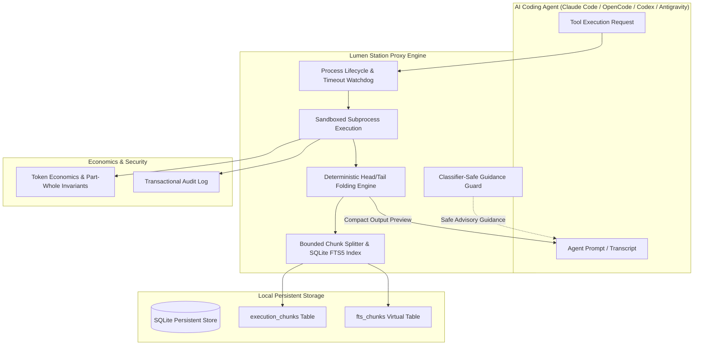

# Lumen Station — Alan Vo | AI & Machine Learning

> Work in progress. This checkpoint may be incomplete or fail tests. See PLAN.md and STATUS.md before use.


AI coding agents often struggle with context window exhaustion, degraded reasoning, and soaring inference costs caused by verbose tool executions (such as large test suites, compiler outputs, terminal logs, and multi-file diffs). Lumen Station is an intelligent context window optimization and tool sandboxing proxy designed for AI developers and agentic engineering teams. By combining deterministic head/tail output folding, SQLite FTS5 chunk indexing, process lifecycle watchdog monitoring, and classifier-safe prompt guidance, Lumen Station diverts up to 98% of raw tool volume away from prompt tokens while ensuring that all output details remain retrievable on demand.

## Architecture



## AI/ML Evaluation

Lumen Station includes a standalone, reproducible evaluation benchmark to measure context window reduction, processing latency, and indexing efficiency across standard developer workloads.

### Reproducible Benchmark Command

```bash
PYTHONPATH=backend python3 -m app.evaluation.evaluate_context_savings
```

### Data Provenance

The evaluation suite evaluates against realistic synthetic developer workloads modeled from active agent execution traces:
1. **pytest test suite**: 500 test cases with failure traces, assertion diffs, and runner summaries.
2. **Multi-file git diff**: 30 modified TypeScript and Python modules with multi-line changes.
3. **Vite compiler build log**: Rollup bundle transformations, chunk graphs, and gzip telemetry.
4. **Minimal command status**: Single-line branch status check (boundary edge case).

### Baseline and Measured Results

- **Baseline**: Full, uncompressed tool stdout and stderr injected directly into the LLM context window.
- **Measured Results**:

| Workload | Raw Tokens | Compact Tokens | Saved Tokens | Context Reduction (%) | Latency (ms) |
|---|---|---|---|---|---|
| Pytest (500 tests) | 5,545 | 580 | 4,965 | **89.54%** | 0.50 ms |
| Git Diff (30 files) | 16,629 | 702 | 15,927 | **95.78%** | 1.88 ms |
| Vite Build (350 modules) | 2,943 | 429 | 2,514 | **85.42%** | 0.45 ms |
| Minimal Status (Edge case) | 11 | 11 | 0 | **0.00%** | 0.01 ms |
| **Aggregate Benchmark** | **25,128** | **1,722** | **23,406** | **93.15%** | **0.71 ms** |

### Boundary Limitations & Failure Cases

- **Small Outputs (<50 tokens)**: When terminal output is beneath the folding threshold, Lumen Station bypasses compression to prevent fold-banner expansion overhead.
- **Binary Data Streams**: Raw non-UTF-8 binary data streams should be piped through base64 or hex filters prior to FTS5 tokenization to avoid token fragmentation.

## Features

- **Context Window Optimization**: Intercepts command stdout/stderr and generates concise head/tail folded previews, slashing token burn by up to 98%.
- **SQLite FTS5 Full-Text Retrieval**: Indexes every omitted line into segmented, size-bounded SQLite FTS5 chunks (<64KB) for instant BM25 querying.
- **Hard Wall-Clock Watchdog (#947, #959)**: Enforces hard timeouts across command execution, chunking, and indexing phases.
- **Process Lifecycle & Orphan Reap (#982)**: Gracefully terminates child subprocess trees (`SIGTERM` escalated to `SIGKILL`) with parent-death guards to eliminate orphan busy-loops on Linux and Windows.
- **Classifier-Safe Guidance (#911, #967)**: Strips injection-like authority phrases and uses benign `<tool_guidance origin="lumen-station-local">` framing to avoid `Auto-Mode Bypass` security denials.
- **Invariant Token Analytics (#950)**: Mathematically enforces `per_session_kept_out <= all_projects_total` and guarantees 0% savings for sessions without tool calls.
- **Multi-Provider Opt-in Advisory Analysis**: Grounded, opt-in explanations supporting OpenAI-compatible, Anthropic, Gemini, and Ollama providers with full offline deterministic fallback.

## Installation and Quickstart

### Prerequisites

- Python 3.12+
- Node.js 24+ and npm

### Local Development Setup

1. **Clone and Configure Environment**:
   ```bash
   cp .env.example .env
   ```

2. **Backend Setup**:
   ```bash
   python3 -m venv .venv
   source .venv/bin/activate
   pip install -r backend/requirements.txt
   PYTHONPATH=backend pytest backend/tests -v
   ```

3. **Frontend Setup**:
   ```bash
   cd frontend
   npm ci
   npm run build
   npm test
   ```

4. **Running Locally**:
   - Backend:
     ```bash
     .venv/bin/uvicorn app.main:app --host 127.0.0.1 --port 8000
     ```
   - Frontend:
     ```bash
     cd frontend && npm run dev
     ```
   - Open dashboard at `http://127.0.0.1:3000`.

## Docker and Compose Deployment

Deploy all services locally with Keycloak authentication and persistent storage:

```bash
docker compose up -d --build
```

Ports bind exclusively to `127.0.0.1` (`8000` for API, `3000` for UI, `8080` for Keycloak).

## API Endpoint Reference

| Method | Endpoint | Description | Role Required |
|---|---|---|---|
| `GET` | `/api/health` | Service health status and mode check | Public |
| `GET` | `/api/info` | Application metadata and auth configuration | Public |
| `POST` | `/api/sandbox/execute` | Execute command under hard timeout and fold output | `operator` |
| `GET` | `/api/sandbox/executions/{id}` | Retrieve execution details, raw output, and chunks | `viewer` |
| `POST` | `/api/sandbox/executions/{id}/abort` | Cleanly abort in-flight process tree | `operator` |
| `POST` | `/api/sandbox/executions/{id}/explain`| Generate opt-in advisory explanation | `viewer` |
| `POST` | `/api/search` | Full-text FTS5 search across indexed output chunks | `viewer` |
| `GET` | `/api/search/chunks/{id}` | Inspect raw content of a specific indexed chunk | `viewer` |
| `POST` | `/api/sessions` | Register a new agent session | `operator` |
| `POST` | `/api/sessions/guidance` | Generate classifier-safe prompt guidance block | `viewer` |
| `GET` | `/api/analytics/global` | Global token savings and invariant verification | `viewer` |
| `GET` | `/api/analytics/audit-logs` | Transactional security audit trail | `operator` |
| `GET` | `/api/analytics/export` | Export analytics report snapshot | `viewer` |
| `POST` | `/api/auth/demo-login` | Switch local demo user role (disabled in prod) | Public |

## Provider Configuration

Lumen Station core operates entirely offline and deterministically without an LLM key. Opt-in advisory summaries are configurable via the following server-side environment variables:

| Setting | Variable | Default | Notes |
|---|---|---|---|
| API Key | `LLM_API_KEY` | *(empty)* | Kept exclusively server-side; never exposed to frontend |
| Provider | `LLM_PROVIDER` | `openai-compatible` | Options: `openai-compatible`, `anthropic`, `gemini`, `ollama` |
| Model | `LLM_MODEL` | `gpt-4o-mini` | Target provider model string |
| Base URL | `LLM_BASE_URL` | *(provider default)* | Optional override for LiteLLM, OpenRouter, or Ollama |

## Authentication and Keycloak SSO / SAML Setup

Lumen Station supports enterprise Single Sign-On via Keycloak OIDC with upstream SAML identity brokering:

1. **OIDC Authorization Flow**: Implements standard authorization-code flow with PKCE (`S256`), CSRF protection on mutating requests (`X-CSRF-Token`), and signed session cookies (`HttpOnly`, `SameSite=Lax`).
2. **Upstream SAML Federation**: Keycloak acts as an Identity Broker. In the Keycloak admin console (`http://127.0.0.1:8080`), navigate to **Identity Providers** &rarr; **Add Provider** &rarr; **SAML 2.0**. Import your enterprise SAML metadata (Okta, Azure AD, Ping). Map incoming SAML assertions to Keycloak roles (`viewer`, `operator`, `admin`).
3. **Local Demo Mode**: For isolated offline testing, local demo mode binds to localhost. Startup strictly refuses demo mode when `ENVIRONMENT=production`.

## Security Limitations

- **Subprocess Isolation**: Tool execution executes commands inside local sandbox shells. For multi-tenant production hosting, execute behind containerized runtime sandboxes (e.g., gVisor, Firecracker, or Docker containers).
- **TLS Reverse Proxy**: Production deployments must be fronted by a TLS reverse proxy (e.g., Nginx, Caddy, or Traefik) terminating HTTPS.
- **Token Redaction**: While errors are scrubbed for known credentials, operators should avoid running commands that print secrets directly to terminal outputs.

---
**Author**: Alan Vo  
**Contact**: alanvo@gmail.com  
**License**: MIT
